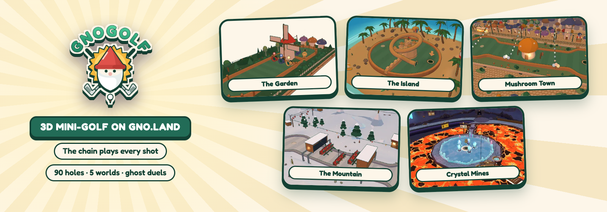
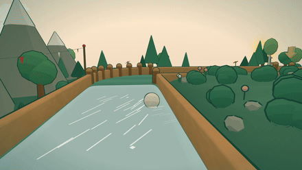
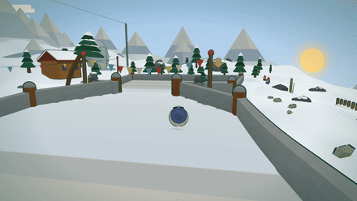
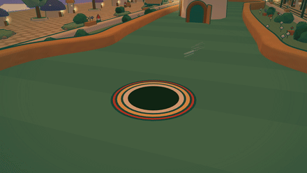

<p align="center">
  
</p>

<h3 align="center">3D mini-golf on the blockchain, where the chain itself rolls the ball.</h3>

<p align="center">
  You pull back, you let go, and a smart contract on <a href="https://gno.land">gno.land</a>
  plays the shot with its own physics.<br>
  Every score is a replay anyone can check: no game server, no way to cheat.
</p>

<p align="center">
  <a href="https://gnogolf.xyz"></a>
  <br>
  <sub>Free, no wallet needed</sub>
</p>

<p align="center">
  
  
  
</p>

## What's in it

- **Five cups, 90 holes**, from the Garden to the Crystal Mines: windmills,
  trams, a volcano, and pieces you have to time.
- **Weather** that turns every five minutes, the same for everyone.
- **Ghost duels**: race anyone's best round, stroke for stroke. The chain kept
  it, so it can't be faked.
- **Boards** for every hole and the whole course, and a link that dares a
  friend to beat you.
- **The Builder**: draw a hole, hole it in every weather, publish it under
  your name.

## How it works

The client never sends "I scored 2". It sends what you decided (an angle, a
power, the moment you let go), and the `golf` realm rolls the ball with its
own physics. Every score is the chain's replay of your shots, so anyone can
check it. Playing is free; keeping a score is one transaction, signed with
[Adena](https://www.adena.app/) or `gnokey`.

## The stack

| Part | Built with |
|---|---|
| **On chain** | [Gno](https://gno.land) realms and packages: the physics, the hole format, the rules, the records, the gnome collection |
| **In the browser** | [three.js](https://threejs.org) for the 3D (cel shading, no textures), plain TypeScript for the engine, React 19 for the interface on top |
| **The site** | [Next.js 15](https://nextjs.org), a static export: plain files, no server, hosted on Netlify |
| **The aim line** | the realm's own Go code built with [TinyGo](https://tinygo.org) to wasm, checked against the chain byte for byte |
| **Wallets** | [Adena](https://www.adena.app/), or a `gnokey` command to paste |
| **Checks** | Gno tests with gas and storage goldens, `node:test`, strict TypeScript, ESLint, goldens for every gnome and every scene |

## Getting started

You need [Go](https://go.dev), [Node](https://nodejs.org) 22.15 or later, and
a [gnolang/gno](https://github.com/gnolang/gno) checkout next to this repo.

Build the onyx toolchain once (onyx runs mainnet's code):

```sh
t=${GNO_TOOLCHAIN:-${XDG_CACHE_HOME:-$HOME/.cache}/gno-toolchains/onyx}
git -C ../gno worktree add ../gno-onyx chain/onyx
(cd ../gno-onyx/gnovm && go build -o $t/gno ./cmd/gno)
(cd ../gno-onyx/gno.land && go build -o $t/gnokey ./cmd/gnokey)
(cd ../gno-onyx/contribs/gnodev && go build -o $t/gnodev .)
```

Then play the whole game on your machine:

```sh
cd web && npm ci && cd ..
scripts/try-local.sh     # a local chain with the 90 holes, two wallets, the site
```

It prints the link to open and the wallets to import in Adena.

## Commands

[](https://github.com/alexiscolin/gnogolf/actions/workflows/check.yml)

```sh
cd web
npm run dev              # the game on http://localhost:3000, against a local gnodev
npm run build            # the static site in web/out
npm test                 # the unit tests

cd ..
scripts/check.sh         # everything that must pass before a commit
SKIP_GNO=1 scripts/check.sh   # the client alone, as the CI runs it
```

## Project structure

```
gno.land/p/gnogolf/   the physics and the hole format, reusable by any Gno game
gno.land/r/gnogolf/   the realms: golf (the rules), store (the records), gnomes, and the 90 holes
web/lib/              the game: engine, 3D scene, Builder, chain client; no React
web/components/       the interface
data/                 the 90 holes as published, and the gnome catalogue
scripts/              checks, deploys, the local playground, end-to-end runs
```

Each of these folders has a README that says where to start.

## Learn more

- [The golf realm on gnoweb](https://onyx.testnets.gno.land/r/nym-alexiscolin000/gnogolf/golf/v2):
  the course, the boards and the source, live on chain.
- [docs/development.md](docs/development.md): running it by hand, the dev
  mode, the checks, writing a hole, deploying the site, who can change what.
- [docs/try-local.md](docs/try-local.md): the whole game on your machine,
  wallets and shop included.
- [CLIENT.md](CLIENT.md): how to write your own client.
- [docs/golf.md](docs/golf.md), [physics](docs/physics.md),
  [course](docs/course.md): the realm's API, the physics, the hole format.
- [docs/pitch.md](docs/pitch.md): the game in one page, to share.
- [gno.land](https://gno.land) and [its docs](https://docs.gno.land): the
  chain Gnogolf runs on.
- [Report a bug or an idea](https://github.com/alexiscolin/gnogolf/issues/new).
