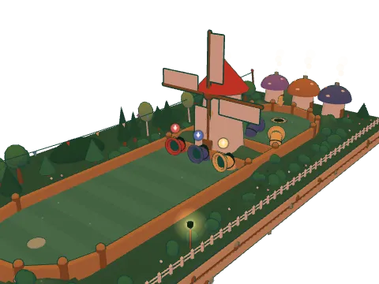
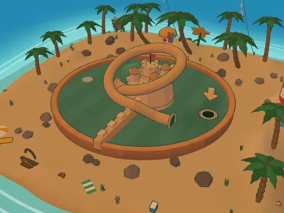
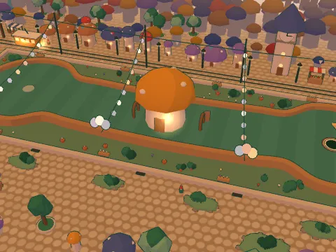
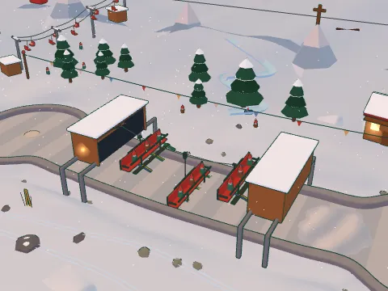
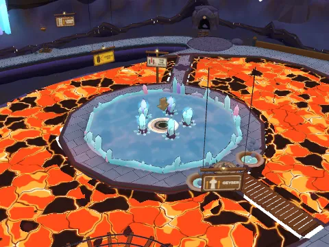

# Gnogolf

[](https://github.com/alexiscolin/gnogolf/actions/workflows/check.yml)

3D mini-golf where the chain rolls the ball. You pull back, you let go, and a
realm on [gno.land](https://gno.land) plays the shot. No game server, and no
way to fake a score.

**[Play at gnogolf.xyz](https://gnogolf.xyz).** Free, no wallet needed.

<table>
  <tr>
    <td><br>The Garden</td>
    <td><br>The Island</td>
    <td><br>Mushroom Town</td>
  </tr>
  <tr>
    <td><br>The Mountain</td>
    <td><br>The Crystal Mines</td>
    <td></td>
  </tr>
</table>

## What's in it

- **Five cups, 90 holes**, from the Garden to the Crystal Mines: windmills,
  trams, a volcano, and pieces you have to time.
- **Weather** that turns every five minutes, the same for everyone.
- **Ghost duels**: race anyone's best round, stroke for stroke. The chain kept
  it, so it can't be faked.
- **Boards** for every hole and the whole course, and a link that dares a
  friend to beat you.
- **The Builder**: draw a hole, hole it in every weather, publish it under
  your name.

## How it works

The client never sends "I scored 2". It sends what you decided (an angle, a
power, the moment you let go), and the `golf` realm rolls the ball with its
own physics. Every score is the chain's replay of your shots, so anyone can
check it. Playing is free; keeping a score is one transaction, signed with
[Adena](https://www.adena.app/) or `gnokey`.

## Run it

With Go, Node 22.15+ and the onyx toolchain built once
([docs/development.md](docs/development.md#the-toolchain)):

```sh
cd web && npm ci && cd ..
scripts/try-local.sh
```

A local chain with the 90 holes, the Builder and the gnome shop, two
throwaway wallets, and the site, ready to play.

## For developers

- [docs/development.md](docs/development.md): the setup by hand, the dev
  mode, the checks, writing a hole, where things live.
- [CLIENT.md](CLIENT.md): how to write your own client.
- [docs/golf.md](docs/golf.md), [physics](docs/physics.md),
  [course](docs/course.md): the realm's API, the physics, the hole format.
- [docs/pitch.md](docs/pitch.md): the game in one page, to share.
